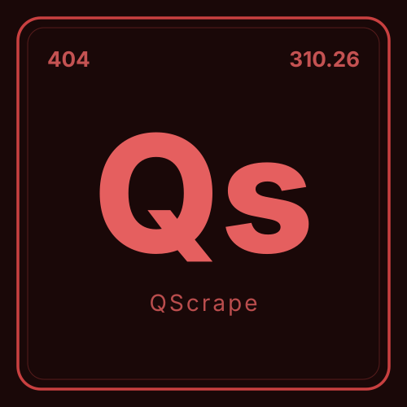

<p align="center">
  <a href="https://qscrape.dev">
    <picture>
      <source media="(prefers-color-scheme: dark)" srcset="media/logo-dark.svg">
      <source media="(prefers-color-scheme: light)" srcset="media/logo-light.svg">
      
    </picture>
  </a>
</p>

<p align="center">
  <a href="https://discord.gg/5WZNzFZtgb"></a>
  <a href="https://opensource.org/licenses/Apache-2.0"></a>
</p>

# QScrape

Web scraper evaluation suite focused on VaultMart, a fictional e-shop with plain HTML, modern framework, and anti-bot experiences.

> [!WARNING]
> QScrape is research tooling for API design and web reverse engineering. **You assume all legal risk for how you use it.** Respect `robots.txt`, rate limits, and IP bans; and please don't bypass them with Tor or a VPN. Read [DISCLAIMER.md](DISCLAIMER.md) before pointing it at anything.

Made by [Cascading Labs](https://cascadinglabs.com), used for [Yosoi](https://github.com/CascadingLabs/Yosoi).

## E-shop experiences

| Experience        | Route        |
| ----------------- | ------------ |
| Plain HTML        | `/l1/eshop/` |
| Modern Frameworks | `/l2/eshop/` |
| Anti-bot          | `/l3/eshop/` |

Existing routes remain stable while the beta is simplified.

## Development

Use Bun 1.4.3 and Node.js 24.11 or newer in the 24.x line (Node.js 24 is used in CI).

```bash
bun install --frozen-lockfile
bun run dev       # http://localhost:4321
bun run build
bun run preview
```

## Lint and format

```bash
bun run check     # Oxfmt format check + Oxlint
bun run lint      # Oxlint, warnings fail the check
bun run format    # Oxfmt
```

## Community

- **Responsible use:** see [DISCLAIMER.md](DISCLAIMER.md)

## Contact

[contact@cascadinglabs.com](mailto:contact@cascadinglabs.com)
