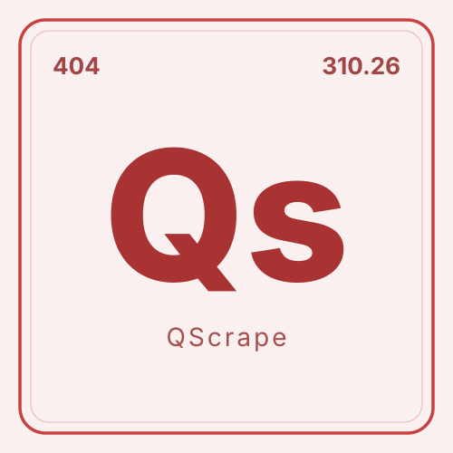

<p align="center"><a href="https://qscrape.dev"></a></p>

# QScrape

A small scraper playground by [Cascading Labs](https://cascadinglabs.com). Choose a site, choose a version, and test against a known collection of synthetic products.

The first site is **Objects**, an eShop of everyday essentials. There are no real purchases, accounts, or payments.

> [!WARNING]
> QScrape is research tooling for API design and web reverse engineering. Respect the policies of any site you test. Read [DISCLAIMER.md](DISCLAIMER.md).

## Explore

| Page               | Route                  | What to expect                                                   |
| ------------------ | ---------------------- | ---------------------------------------------------------------- |
| Playground         | `/`                    | One eShop entry point                                            |
| eShop versions     | `/eshop/`              | Choose HTML or JavaScript                                        |
| HTML eShop         | `/eshop/html/`         | Astro generates product content as static HTML at build time     |
| JavaScript eShop   | `/eshop/javascript/`   | One client-only React island; JavaScript required for extraction |
| Catalogue fixtures | `/eshop/fixtures.json` | Expected IDs, prices in cents, stock, and product fields         |

Every version has product pages and a local sample cart. HTML catalogue extraction and navigation work with JavaScript disabled; cart interactions require JavaScript. Cart state stays in your browser and is separate for each version.

Source references on the version picker use a published commit when `PUBLIC_SOURCE_REVISION`, `CF_PAGES_COMMIT_SHA`, or `GITHUB_SHA` is available. Local builds show the source paths and repository link until the code is published.

## Styling

The homepage and version picker use `PlaygroundLayout` and the original QScrape stylesheet, with a compact layout based on CascadingLabsFE. The shop versions use `ShopLayout` and their own `shop.css` theme, typography, navigation, and page width. Shop pages do not load the QScrape index stylesheet or its header/footer.

## Development

Use Bun 1.4.3 and Node.js 24.11 or newer in the 24.x line.

```bash
bun install --frozen-lockfile
bun run dev
bun run check
bun run build
bun run preview
```

Astro 7 builds with Vite+ core, Rolldown, and Oxc. The only client framework is React. Update `vite-plus` and the `vite` alias/override together. Formatting and lint configuration live in `vite.config.ts`.

```bash
bun run format       # Oxfmt, one thread
bun run lint         # Oxlint, one thread; warnings fail
bun run check        # Read-only format and lint checks, sequentially
```

Oxfmt currently skips Astro templates. Oxlint checks their scripts; the Astro production build validates the templates.

## Content and contracts

The canonical dataset is `src/data/eshop/catalog.ts`. Prices are integer USD cents. Product IDs, content, and inventory are identical across versions. One item is out of stock so extraction and cart availability can be checked independently.

| Product ID | Name               | Price  | Stock |
| ---------- | ------------------ | ------ | ----- |
| obj-001    | Arc desk lamp      | $68.00 | 12    |
| obj-002    | Loop ceramic mug   | $24.00 | 8     |
| obj-003    | Grid notebook      | $18.00 | 24    |
| obj-004    | Daybreak tote      | $32.00 | 5     |
| obj-005    | Pebble catchall    | $28.00 | 0     |
| obj-006    | Still glass bottle | $36.00 | 9     |

## Restart and migration

The old VaultMart implementation and numbered-level routes have been retired. Their product IDs and special URL encodings do not map to this new collection. External examples that relied on the retired shop must choose a new route and update their expected product IDs and values. No legacy compatibility layer is included.

## Contact and license

[contact@cascadinglabs.com](mailto:contact@cascadinglabs.com) · [GitHub](https://github.com/CascadingLabs/QScrape) · [Apache-2.0](LICENSE)
